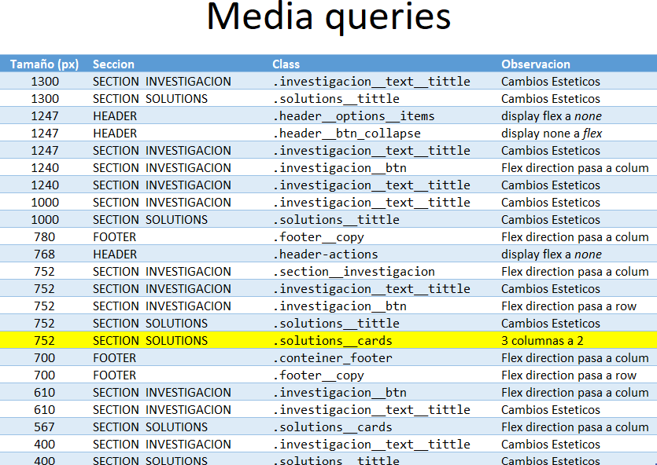

# Entrega: Maquetación de página web

## Objetivo

Para esta entrega deberán realizar la **maquetación de la siguiente página de referencia**, intentando reproducir fielmente su estructura, diseño y comportamiento responsive.

[OpenAI – Research](https://openai.com/es-419/solutions/use-case/research/)

## Criterios de evaluación

Se tendrán en cuenta los siguientes aspectos:

- **Cumplimiento:** implementación de todos los componentes solicitados.
- **Diseño responsive:** adaptabilidad a diferentes tamaños de pantalla.
- **HTML semántico:** uso correcto de las etiquetas HTML.
- **Organización del código:** limpieza, claridad y estructura del HTML y CSS.
- **CSS:** uso adecuado de selectores, clases y propiedades.
- **Fidelidad visual:** similitud con el diseño original de referencia.

## Consideraciones personales

Algunas decisiones tomadas durante el desarrollo:

- **Tipografía:** utilicé *Inter*, ya que me pareció la opción más adecuada para reproducir el estilo visual de la página.
- **Tamaños tipográficos:** opté por tamaños de fuente ligeramente menores que los de la página original.

- **Unidad relativa de tamaño:** Se creo una unidad relativa de tamaño que da una idea de la relacion de 1 px, con el View port

                                --rel1px: (1px*100)/1440=0.069444vw;

## Media Queries

Para adaptar el diseño a distintos dispositivos, utilicé *media queries* tomando como referencia los valores responsive de la página original.

